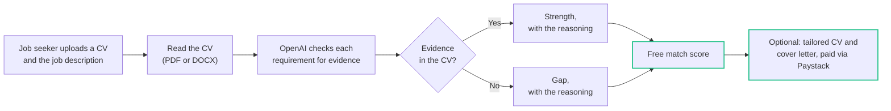

# Hi, I'm Julie Adul

Full stack developer and Growth Hacker at [Wakandi Kenya](https://wakandi.com) (since November 2026, after a Growth Hacker internship there from August to October 2026). I build web products for businesses and the communities around them, then work on getting people to use them.

I trained as an English and Literature teacher, so I care a lot about whether the person on the other side understands what they're looking at.

**Portfolio:** [julieadul.site](https://julieadul.site) (backup: [julieadul.pages.dev](https://julieadul.pages.dev)) · Open to full-time roles and freelance projects

## What I'm working on now

November 2026

- **Simpler versions of CAMs and ChurchPay at Wakandi Kenya.** CAMs is for running a SACCO (members, savings and loans), and ChurchPay is for church giving and records.
- **CS50 at Harvard**, in progress.
- **My portfolio**, [julieadul.site](https://julieadul.site): prerendered so search engines and AI assistants can read it, with an OpenAI chat assistant that answers questions about my work and passes contact requests to me.

## What I've built

| Project | What it does | Built with |
| --- | --- | --- |
| [AICVPro](https://aicvpro.co.ke) | AI CV analyzer for the Kenyan job market. Free match scores for job seekers, tailored CVs, and bulk CV screening for hiring managers | React, Supabase Edge Functions, OpenAI API, Paystack |
| [OmniConnect Pay](https://github.com/jbestcodes/omniconnect-wifi-saas) | Dashboard for running a paid Wi-Fi hotspot business: packages, voucher codes, Paystack payments, revenue analytics | Next.js, TypeScript, Paystack, Docker |
| [Jaza Nyumba](https://jazanyumba.online) ([code](https://github.com/jbestcodes/Chama-Vault)) | Chama (savings group) platform: member approval, contribution schedules, loans from application to repayment, SMS and email reminders, an AI financial assistant, Paystack subscriptions; works offline as an installable app | React, Node.js, MongoDB, OpenAI API, Paystack, SMS Leopard |
| [AfyaPulse](https://afyapulse.vercel.app) ([code](https://github.com/jbestcodes/Afyapulse)) | AI symptom checker for Kenya with M-Pesa payments for detailed reports | React, Node.js, MongoDB, Hugging Face, M-Pesa Daraja |
| [Loopping](https://loopping.netlify.app) | Follow-up reminders for business owners, so no lead is forgotten | React, Firebase |
| [School Fee Management](https://schoolfee.netlify.app) | Multi-school fee tracking (balances, charts, class-by-class debtors, CSV import) with admin and parent logins and a parent portal | React, Tailwind CSS, Recharts, Node.js, Express, PostgreSQL |
| [Village Verdict](https://github.com/jbestcodes/village-verdict) | Social deduction game that runs inside Reddit | TypeScript, Phaser, Devvit, Hono, tRPC, Redis |

I've also built websites for [AMIG International Consultants](https://amig.co.ke), [TopJob Human Resources](https://jbestcodes.github.io/TopJob), [Paris Barbershop & Spa](https://parisbarbershopspa.pages.dev), [Bukachi Hope Givers](https://www.bukachihopegivers.org) and [Hope Excellence Association](https://hope-excellence-association.vercel.app).

## How AICVPro scores a CV

Most applicant tracking systems count keywords. AICVPro checks each requirement in the job description for evidence in the CV, and explains every rating.

Hiring managers get the same analysis for up to 200 CVs at once, exportable as CSV.

## Timeline

| When | What happened |
| --- | --- |
| 2019 | Bachelor of Education (Arts), English and Literature, Kenyatta University |
| 2025 | Software Development Program (MERN stack), Powerlearn Project Africa |
| Aug 2025 | Started Jaza Nyumba (chama management), AfyaPulse (AI symptom checker) and the TopJob website |
| Jan 2026 | AMIG International Consultants website |
| Apr 2026 | OmniConnect Pay (Wi-Fi hotspot business dashboard) |
| Jun 2026 | School Fee Management, a multi-school fee tracker with a parent portal |
| Jul 2026 | Village Verdict, a game that runs inside Reddit |
| Aug 2026 | Joined Wakandi Kenya as a Growth Hacker Intern |
| Nov 2026 | Growth Hacker at Wakandi Kenya, working on simpler versions of CAMs and ChurchPay |

## How I work

| Principle | What it means |
| --- | --- |
| **Technology should serve people** | I start from the person using it: a chama treasurer, a church secretary, a hiring manager with 200 CVs. |
| **Quality over quantity** | Fewer features, done properly and shipped, beats a long list that half works. |
| **Problems are puzzles** | I like the hard part: turning messy records or a pile of CVs into something clear. |
| **Always learning** | Right now that's CS50 and growth work at Wakandi Kenya. |

## Beyond code

- **I run chama groups.**
- **I import products** of different kinds.
- **To wind down**, I watch movies and take walks.

## Tools I use

- **Frontend:** React, TypeScript, Vite, Tailwind CSS, Next.js
- **Backend:** Node.js, Express, Supabase Edge Functions
- **Data:** MongoDB, Supabase, Firebase, MySQL
- **AI and payments:** OpenAI API, Hugging Face, Paystack, M-Pesa Daraja
- **Websites:** WordPress, WooCommerce

## Get in touch

- Portfolio and chat assistant: [julieadul.site](https://julieadul.site) (backup: [julieadul.pages.dev](https://julieadul.pages.dev))
- WhatsApp: [0799 590 637](https://wa.me/254799590637)
- LinkedIn: [linkedin.com/in/julie-adul](https://www.linkedin.com/in/julie-adul)
